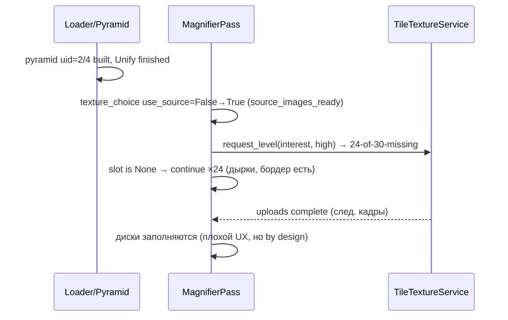
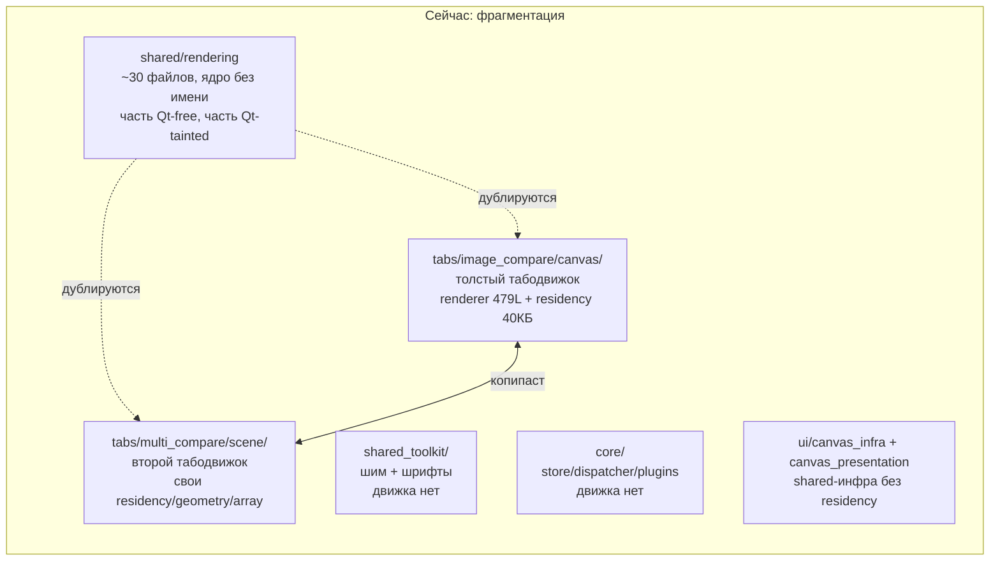
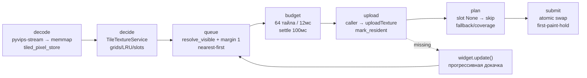
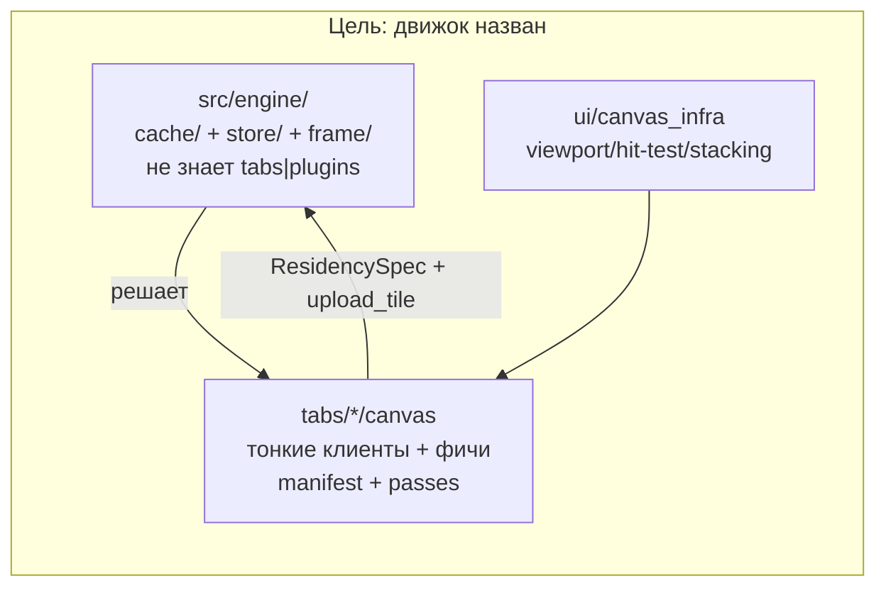
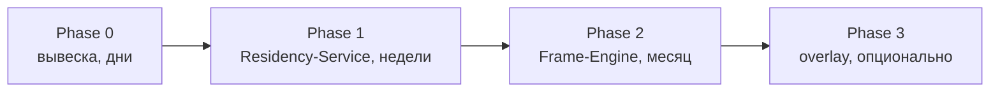
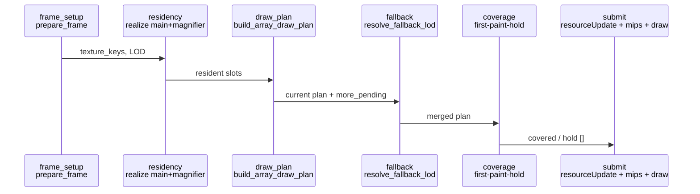
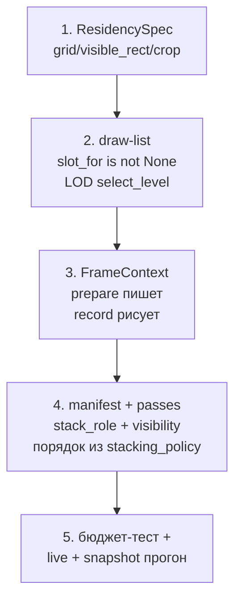

# Plan: собственный движок поверх тайлов (дешевле производить, без полумер)

Status: `Draft`
Area: `src/shared/rendering/` (ядро ~30 файлов, Qt-free частично), `src/tabs/image_compare/canvas/` (табодвижок), `src/tabs/multi_compare/scene/`, `src/ui/canvas_infra/` + `src/ui/canvas_presentation/`, `src/shared_toolkit/` (шим), `src/core/` (не движок)
Related: [ARCHITECTURE.md](ARCHITECTURE.md) слои, [CODE_PATTERNS.md](CODE_PATTERNS.md) thin owner + `use_cases/`, [CONTRACTS.md](CONTRACTS.md) изоляция, [rendering/tile-rendering-system.md](rendering/tile-rendering-system.md), [rendering/rendering-model.md](rendering/rendering-model.md), [rendering/render-pass-contract.md](rendering/render-pass-contract.md)

## 0. Кратко для занятых

Движок уже наполовину написан (`shared/rendering` + `shared/image_processing`), но не назван — поэтому base image доведён до ума, а лупа/дифф/экспорт едят тайлы кто во что горазд. Предложение: Phase 0 — дать вывеску и запретить движку знать про табы (день мержа фрагментация останавливается); Phase 1 — запечатать Residency-Service (лечит дырки лупы); Phase 2 — Frame-Engine с шиной `FrameContext`; Phase 3 — опциональный immediate-overlay для мелочи. Порядок важен: 1 → 2 → 3, наоборот — полумера.

## 1. Симптом и диагноз

### 1.1 Симптом (UX, воспроизведено 2026-09-14)

Лупа после флипа `stored → source` показывает дырки (`24-of-30-missing` ×24 строки в одну миллисекунду), потом дозаполняется:

Корень: флип `use_source` гейтится на `source_images_ready` (`canvas/features/magnifier/render/magnifier_pass.py:413-421`), а не на residency; дроп — чистый `continue` без fallback (`magnifier_pass.py:160-188,591-592`); в лог `tile_index` не входит (`loupe_trace.py:126`), поэтому 24 разных sig выглядят как 24 идентичные строки.

### 1.2 Диагноз (структура): движок без вывески

Детализация:

- Ядро без вывески (Qt-free): `tile_texture_service.py`, `residency.py` (`TileResidencyRealizerBase.realize_specs`), `lod.py` (`select_level`), `fallback_lod.py`, `tile_coverage.py`, `tile_upload_budget.py`, `tile_constants.py`, `layout_contract.py`, `screen_projection.py`, `image_identity.py`, `display_image_picker.py`. Qt-tainted рядом: `array_resources.py`, `host_texture_cache.py`, `mip_cascade.py`, `export_tiling.py`, `offscreen_canvas.py`, `tile_prefetch.py`, `coalesced_flush.py`.
- `src/shared_toolkit/` — не движок (шим + шрифты + старые диалоги). `src/core/` — не движок (store/dispatcher/plugins).
- Разнобой «все решают по-разному»: throttle — пер-модульные `_last_*_sig` (`draw_plan.py:40`, `renderer.py:108`, `coverage.py:45`, `fallback.py:50`, `frame_setup.py:35`, `lod_commit.py:36`) вместо общего `loupe_trace.py:84`; три разных `Tracer`-синглтона; `register_interest_rect` advisory — никто не читает (`tile_texture_service.py:360-380`); thin owner рядом с толстыми классами (`multi_compare/controller.py` 506L vs IC 261L, `draw_plan.py`, `base_images.py`, `export/dialog.py` 732L — санкционированы, но рядом).

| Дубликат | Экземпляры |
|---|---|
| residency | shared `residency.py` + `rhi_renderer/residency.py` + `multi_compare/scene/passes/residency.py` |
| tile_geometry | shared `tile_geometry.py` + `texture_parts/tile_geometry.py` + `multi_compare/scene/tile_geometry.py` |
| upload | `rhi_renderer/resources.py` + `texture_parts/upload_queue.py` + `array_resources.py` |
| plan_applicator | shared `ui/canvas_presentation/plan_applicator.py` + табовой `canvas/presentation/plan_applicator.py` |
| coverage/drop_covered | `rhi_renderer/draw_plan.py:267` + `multi_compare/.../tile_geometry.py:143` |
| array_resources subclass | IC `rhi_renderer/array_resources.py:47` + MC `scene/passes/array_resources.py:49` |

## 2. Что уже адекватно (base image — эталон, не ломать)

Без дыр по построению: `slot is None → skip` (`draw_plan.py:461-491`) + `fallback_lod` (promotion при `not more_pending`), `atomic` при content-swap, `first-paint-hold → []` (`coverage.py:403-432`), покрытие только по resident (порог 0.98), rekey старого (`residency.py:191-213`), prefetch 8, защита всего target от thrash (`residency.py:164-168`).

Чего у фич нет (разрыв — список работ Phase 1): fallback-LOD, coverage/hold, low-res уровень (лупа всегда `quality="high"` level 0), приоритет lens-интереса в очереди, `more_pending`-гейт промоушена, прогрев diff-резиденси для лупы (`tile_residency.py:174` `diff_key=None`). Diff: residency тот же, но покрытия по diff нет, генерация CPU-async, тестов 0. Preview: целый QImage-пикер + holds (`_preview_stash`, `extra_protect_keys`), тестов на holds 0. Export: live residency вообще не использует — свой CPU-prescale + framebuffer-тайлинг 4096, diff запечён; LOD-функция общая, данные scaled; harness-теста паритета нет.

## 3. Индустриальные прецеденты (коротко: урок → наш запрет)

| Кто | Урок | Наш запрет |
|---|---|---|
| Godot `servers/` RID | `get()` из сервера каждый кадр = flush | Сервис читают кадром через realizer, не дёргают |
| Bevy Extract | Мутация мейна из рендера = смерть pipelining | Движок не мутирует таб-стейт |
| Hazel lib vs Sandbox | Движок знает пути игры = не шиппается | `engine/*` не импортирует `tabs\|plugins` даже строками |
| Willems `base/` vs `examples/` | «Подкручу базу под пример» ломает соседей | Специфика в хуке, база общая |
| Qt QRhi | Native GL/Vk мимо RHI умер на Qt6 | `uploadTexture`/FBO мимо сервиса запрещены |
| Unreal VT / id MegaTexture | Coarse всегда resident, oversubscribe → mip-bias (мыло, не дыры) | Pin coarsest от eviction + fallback из coarse |
| deck.gl / OSD | `best-available`: pending закрывает родитель; overview-first | Ancestor вместо дырки |
| OpenSlide/QuPath | `read_region(downsample)` + `Cache(bytes)` LRU; пустое — alpha | Low-res всегда resident |
| napari | Model → Qt → vispy только событиями; `screenshot` vs `export_figure` разные осознанно | Слою запрещены Qt в модели, full-res заливка, пересборка сценграфа на тайл |
| BigDataViewer `Volatile` | Missing = подмена из грубого + дорисовка | Рендерер opportunistically юзает кэш |
| ITK/VTK pull | `INFORMATION` без IO; `Enlarge→Largest` убивает стриминг | Метаданные без full-res (`materialize_full` уже запрещён) |
| QVTKAdapter | `paintGL` только blit, не `Render()` | `paint` не рендерит |

## 4. Предложение: 3 фазы + вывеска

### Phase 0 — вывеска (дни, поведения ноль)

Переименовать `src/shared/rendering/` → `src/engine/cache/` + `src/engine/store/` (или оставить путь, но зафиксировать в `ARCHITECTURE.md`: «это движок»). Добавить `tests/contracts/test_engine_no_app_imports.py`: AST — `engine/*` ∩ `tabs|plugins` = ∅, включая строковые литералы таб-путей (нынешние `tile_constants.py:108`, `offscreen_canvas.py:4` вычистить). Эффект: фрагментация останавливается в день мержа. Цена: почти ноль, риск: ноль.

### Phase 1 — Residency-Service (недели, рекомендовано первым, лечит лупу)

Запечатать сервис как единственный API: гриды, `resolve_visible_tiles`, `realize_specs`, `evict_over_budget`, `select_level`, покрытие через `slot_for`. Табы — тонкие клиенты.

Конкретно:
- Убрать `_realize_tile_residency` в MC; единый `BaseImagesPass` по мотивам IC `draw_plan+residency`.
- Lens-интерес первым классом в `select_upload_batch` (сейчас advisory, никто не читает).
- Pin coarsest-уровня от eviction (Unreal-рецепт: всегда есть что семплировать).
- Лупа: `use_source`-гейт на residency (держать stored до resident — атомарный своп) + low-res fallback дропнутых слайсов (мыло 1–2 кадра вместо дырок) + `tile_index` в reason лога или агрегация.
- Прогреть diff-резиденси для лупы (`diff_key=None` → реальный ключ).

Контракты: `test_no_private_grid.py` (вне `engine` нет `dict[source→grid]`, нет прямых `QRhiTexture`-аллокаций под тайлы), `test_coverage_uses_slot_for.py`. Пассы не трогаем — дёшево.

### Phase 2 — Frame-Engine (месяц, когда сервис стабилен)

`src/engine/frame/{context.py, graph.py, executor.py}` + `src/engine/passes/base_images.py` (схлопнуть draw_plan+residency обоих табов; таб-хуки: resolve specs + upload_tile). Кадр как конвейер:

`FrameContext` — шина кадра: сейчас пишут только `mag_gate` и `fallback`, читателей продакшена ноль. Добавить frame_id, viewport-hash, budget-статистику, схему `ids`. Снапшот-билдеры (`snapshot_render_plan_builder`, `video_snapshot_rendering`, `image_export/context_builder`) → табовые `snapshots/` (live + snapshot-replay по `rendering-model.md`; `if mode=="export"` в пассе запрещён). Контракт: `test_pass_reads_only_ctx.py` (`record()` без `widget./store.` кроме `ctx`).

### Phase 3 — Immediate-overlay (опционально, точечно)

Аннотации/handles/guides/grid — per-frame `overlay.draw_*()` в один HUD-пасс вместо долгоживущих QRhi-пассов. Только для мелочи. Запрет: `overlay.py` без классов с pipeline/buffer, без `import store` (`test_overlay_stateless.py`). Риск: соблазн тащить immediate туда, где нужен retained lifecycle — не делать ядром.

## 5. Как писать новую фичу (чеклист → в `CODE_PATTERNS.md`)

1. `ResidencySpec` — не свой грид; residency только через `realize_specs`, эвикт только `evict_over_budget`.
2. Draw-list фильтровать по `slot_for is not None`; LOD только `select_level`; паддинги — в `CanvasGeometry`, не в пикселях.
3. Читать только из `FrameContext`, не из виджета/Store в `record()`; `prepare` пишет в `resource_updates`, `record` только рисует.
4. Манифест `manifest.py` + `RENDER_PASSES` с `stack_role+visibility`; `if mode` в пассе запрещён.
5. Бюджет-тест (count+time, `update()` при `batch<missing`) + live+snapshot прогон.

## 6. Запреты полумер (каждый — контрактный тест)

1. Движок не импортирует табы (код + строки) — Hazel-кейс.
2. `uploadTexture`/FBO мимо сервиса запрещены — Willems/QRhi-кейс.
3. Coverage только по `slot_for is not None` — иначе дырки по построению.
4. Coarse всегда resident (pin от eviction) — Unreal/id-кейс.
5. Метаданные без full-res (`REQUEST_INFORMATION` без IO) — ITK-кейс.
6. Никакой пересборки сценграфа/pipeline на тайл — только атлас-апдейты (napari-кейс).
7. `paint` не рендерит, только blit (QVTK-кейс); интерактив грубый, экспорт сходящийся (napari/VTK-кейс).

## 7. Экономика: почему дешевле

- Phase 0 окупается сразу: новые дубли ловятся тестом, а не ревью.
- Phase 1 убирает самый дорогой дубль (IC↔MC residency/draw-plan) и главный UX-долг (дырки лупы) без переписывания пассов.
- Phase 2 убирает второй дубль (пассы) и `if mode`-дрейф live/export — после неё новая фича пишется по чеклисту из 5 шагов вместо копипасты двух табодвижков.
- Порядок 1→2→3 обязателен: наоборот (пассы раньше сервиса) — та же полумера Willems-кейса.

## 8. Верификация

- `python src/devtools/docs_link_graph.py --write-index` (после добавления/перемещения доков).
- `./launcher.sh test tests/contracts -q` — старые + новые engine-тесты.
- `QT_QPA_PLATFORM=offscreen pytest src/tabs/image_compare/tests/render/ src/tabs/multi_compare/tests/ -q -p no:cacheprovider`.
- `IMGSLI_IC_LOUPE_DEBUG=1` — повтор сценария из §1.1: дырок нет (stored-hold или low-res fallback до resident), лог без 24 идентичных строк.
